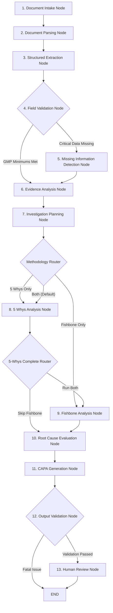

# AIVOA.AI RCA Intelligence – LangGraph AI Workflow Specification

## 1. Overview
The investigation workflow is orchestrated via a compiled LangGraph `StateGraph` containing **13 dedicated nodes** with dynamic conditional branching. The architecture incorporates **real-time Groq LLM inference** (`openai/gpt-oss-120b` via `langchain-groq`), structured RFC 8259 JSON validation, and rigorous cGMP pharmaceutical non-fabrication safeguards.

**Engineering Decision-Support Prototype Classification:**
AIVOA.AI is engineered strictly as an engineering decision-support tool. It assists pharmaceutical quality investigators by extracting evidence, identifying missing information, drafting 5-Whys chains, and structuring Fishbone diagrams. The system never makes autonomous regulatory determinations:
- AI-generated root causes are locked to status `PROPOSED` (`is_ai_suggested=True`, `is_verified=False`) and cannot be automatically confirmed.
- Downstream confirmation requires human investigator review, independent empirical verification links, and formal `QA_APPROVER` or `ADMIN` electronic sign-off.
- The platform does not claim autonomous 21 CFR Part 11 or GMP certification; it provides technical controls designed to support compliance under human oversight.

---

## 2. 13-Node Graph Architecture

---

## 3. Detailed Node Specifications

### Node 1: `document_intake_node`
- Validates payload presence and enforces a strict 10 MB maximum size ceiling.
- Verifies input type (`PDF`, `TEXT`, `EMAIL`).
- Logs initial ingestion telemetry.

### Node 2: `document_parsing_node`
- Streams PDF byte content into memory via `pypdf.PdfReader` with page-by-page text extraction.
- Parses email headers (From, Subject, Date) and message body per RFC 5322.
- Normalizes whitespace and standardizes manufacturing character encodings.

### Node 3: `structured_extraction_node`
- Executes Groq LLM inference using `ChatGroq` (`openai/gpt-oss-120b` dynamically cataloged).
- Ingests structured multi-page document metadata and extracts 16 canonical pharmaceutical parameters:
  1. Deviation Title
  2. Deviation ID
  3. Incident Date & Time
  4. Batch Number
  5. Product / API Name
  6. Manufacturing Process / Unit Operation
  7. Equipment / Asset Identifier
  8. Process Parameter
  9. Approved Operating Range
  10. Observed Value
  11. Duration of Deviation
  12. Incident Description
  13. Immediate Actions Taken
  14. Potential Product / Batch Impact
  15. Available Evidence
  16. Conflicting Information
- **Deterministic Citation Grounding & Status Classification:**
  - `SOURCE_FACT`: Exact or normalized substring match in source document text, verified page number, and confidence $\ge 0.95$. Token overlap alone is strictly rejected for `SOURCE_FACT`.
  - `AI_INFERENCE`: Inferred or paraphrased parameter with validation reason; ungrounded citations or embedded fabrications are demoted here.
  - `MISSING`: Parameter explicitly unrecorded or absent from source text (`value=None`). Unrelated text produces 0 fabricated incident details.
  - `CONFLICTING`: Conflicting evidence detected across document streams or sensor telemetry (e.g. SCADA valve demand 100% vs actual position feedback 12%).
- Uses `document_parser.validate_source_citation` to verify continuous verbatim substrings and reject hallucinated quotes, embedded quote fabrications (`EMBEDDED_FABRICATION`), or modified numeric metrics before presenting fields to the investigator.
- **Explicit Human Acceptance Gate:** All extracted fields initialize with `is_accepted=False`. In accordance with cGMP data governance principles, fields cannot be committed to the investigation without explicit investigator approval or review. Server-side revalidation independently enforces acceptance and verifies citations against persisted raw document text prior to database persistence.

### Node 4: `field_validation_node`
- Audits required cGMP parameters (Batch Number, Product Name, Technical Description).
- Determines `is_valid` flag.
- Generates validation error records for missing required attributes.

### Node 5: `missing_information_detection_node`
- Identifies critical evidence gaps (e.g. calibration certificates, mother liquor testing, operator shift handover logs).
- Generates prioritized investigator questions categorized by domain (`GMP_BATCH_RECORD`, `SENSOR_CALIBRATION`, `RAW_MATERIAL`).

### Node 6: `evidence_analysis_node`
- Correlates documented findings with deviation failure symptoms.
- **Runtime Source Citation Validation (Phase 2C.1):** Executes `validate_source_citation` against physical document text blocks:
  - Validates continuous verbatim substring occurrences and normalized whitespace.
  - Rejects fabricated quotations and altered numerical values (e.g. fabricated temperature or yield deviations).
  - Flags ungrounded citations in the investigation `trace_log` with detailed diagnostics.
  - Excludes ungrounded findings from `supporting_findings` so downstream root cause synthesis cannot cite fabricated evidence.
- Partitions verified empirical records into `SUPPORTING` and `CONTRADICTORY` evidence categories.
- Inspects narrative for evidence conflicts (e.g. SCADA sensor readings contradicting operator logbook statements).
- Flags `has_conflicting_evidence` and `is_evidence_insufficient` to constrain subsequent causal claims.

### Node 7: `investigation_planning_node`
- Formulates the methodology execution plan (`5_WHYS`, `FISHBONE_6M`, or `BOTH`).
- Prepares unified execution parameters to eliminate redundant LLM calls.

### Node 8: `five_whys_analysis_node`
- Formulates a sequential causality chain from direct symptom to root systemic vulnerability.
- **Dynamic Depth & Non-Fabrication (Phase 2D.2.1):** Does not force artificial padding to exactly 5 iterations if the incident data only supports fewer levels of inquiry. Eliminates all synthetic constants (`38.4°C`, `22.0°C`, `MW-2026-1049`, `SOP-MAINT-102`, etc.). Unrelated non-manufacturing text generates 0 fabricated incidents.
- Reuses the unified RCA analysis payload from state, avoiding duplicate inference calls.

### Node 9: `fishbone_analysis_node`
- Classifies causal factors across Ishikawa 6Ms: **Man, Machine, Material, Method, Measurement, Milieu**.
- **Dynamic Category Coverage (Phase 2D.2.1):** Empty categories with no documented evidence remain empty rather than having dummy synthetic causes injected.
- Categorizes each factor status as `HYPOTHESIS` or `RULED_OUT`. Never outputs `CONFIRMED` without human QA sign-off.
- Reuses unified RCA payload from state.

### Node 10: `root_cause_evaluation_node`
- Synthesizes primary root causes and contributing factors, attaching traceable evidence identifiers.
- **Safety Enforcement (Phase 2D.2.1):** If `has_conflicting_evidence` is true or evidence is unverified/insufficient, forces root cause status to `PROPOSED` with an explicit conflict warning. All AI-generated root causes strictly default to `PROPOSED`, `is_ai_suggested=True`, and `is_verified=False`. Status `CONFIRMED` is strictly reserved for human investigator/QA sign-off.
- Generates `RootCauseEvidenceLink` junction mappings for investigator review.

### Node 11: `capa_generation_node`
- Generates structured action items:
  - **Correction**: Immediate containment and segregation of affected batch material.
  - **Corrective Action**: Root cause remediation targeting equipment/process failure mode.
  - **Preventive Action**: Facility-wide systemic controls and preventive maintenance schedules.
- Suggests assignees, deadlines, and quantitative effectiveness review criteria.

### Node 12: `output_validation_node`
- Validates all output schemas using Pydantic.
- Enforces non-fabrication constraints: all AI outputs are tagged `is_ai_suggested=True` and `is_verified=False`.
- Reverts any unauthorized `CONFIRMED` statuses to `PROPOSED`.

### Node 13: `human_review_node`
- Packages the complete investigation dossier for investigator verification, editing, and QA electronic sign-off.
- Sets `human_approved=False` and `current_step="READY_FOR_INVESTIGATOR"`.

---

## 4. Conditional Routing Logic

1. **Post-Validation Routing (`route_after_validation`):**
   - If `not state["is_valid"]`: routes to `missing_information_detection` to formulate critical batch inquiry questions before continuing.
   - If valid: routes directly to `evidence_analysis`.
2. **Post-Planning Routing (`route_after_planning`):**
   - If `selected_methodology == "FISHBONE_6M"`: routes directly to `fishbone_analysis` (skips 5-Whys).
   - If `selected_methodology == "5_WHYS"` or `"BOTH"`: routes to `five_whys_analysis`.
3. **Post-5-Whys Routing (`route_after_five_whys`):**
   - If `selected_methodology == "5_WHYS"`: routes directly to `root_cause_evaluation` (skips Fishbone).
   - If `"BOTH"`: routes to `fishbone_analysis`.
4. **Post-Validation Routing (`route_after_output_validation`):**
   - If outputs valid: routes to `human_review`.
   - If fatal safety or schema issue: routes to `END`.

---

## 5. LLM Call Optimization & Deduplication

| Metric | Before Remediation | After Remediation | Optimization Result |
| :--- | :--- | :--- | :--- |
| **Intake Extraction Calls** | 1 call | 1 call | Unchanged |
| **5 Whys Analysis Calls** | 1 call | 1 unified call (cached in state) | Shared across downstream nodes |
| **Fishbone 6M Calls** | 1 duplicate call | 0 calls (reads state) | 100% eliminated |
| **Root Cause Evaluation Calls** | 1 duplicate call | 0 calls (reads state) | 100% eliminated |
| **CAPA Generation Calls** | 1 duplicate call | 0 calls (reads state) | 100% eliminated |
| **Total Full Pipeline Calls** | **5 calls** | **2 calls** | **60% reduction in API calls & latency** |
| **Single Methodology Calls** | 5 calls | 1 call | **80% reduction** |

---

## 6. Groq Multi-Key Failover, Error Classification & Quota-Aware Architecture (Phase 2D.2.1.2)

- **Standardized Exception Hierarchy**:
  - `GroqRateLimitError` $\to$ HTTP 429 (`RATE_LIMIT_EXCEEDED` / `QUOTA_BLOCKED`)
  - `GroqAuthenticationError` $\to$ HTTP 401 (`AUTHENTICATION_FAILED` / `AUTH_ERROR`)
  - `GroqPermissionError` $\to$ HTTP 403 (`PERMISSION_DENIED`)
  - `GroqTimeoutError` $\to$ HTTP 408 (`REQUEST_TIMEOUT`)
  - `GroqConnectionError` $\to$ HTTP 503 (`SERVICE_UNAVAILABLE`)
  - `GroqServiceError` $\to$ HTTP 503 (`SERVICE_UNAVAILABLE` / `AI_UNAVAILABLE`)
- **Quota-Aware Failover Rules**:
  - **401 Unauthorized:** Invalid or revoked primary credentials attempt the backup credential in request scope. If both fail, returns `AI_UNAVAILABLE`.
  - **Organization-Level 429 (TPD / TPM / ITPM / OTPM):** Immediately halts rotation and returns `QUOTA_BLOCKED`.
  - **Project-Level 429:** Backup credential is only attempted if separate projects are explicitly configured (`GROQ_PROJECT_ID` != `GROQ_BACKUP_PROJECT_ID`). Otherwise returns `QUOTA_BLOCKED`.
  - **Unknown / Ambiguous 429:** Fails safely without rotation, returning `QUOTA_BLOCKED`.
  - **403 Forbidden:** Classifies as `GroqPermissionError` without repeating identical unauthorized requests.
  - **Provider Outage:** Bounded retries across candidate models; no key rotation.
- **Concurrency-Safe Request-Scoped Credential Selection**:
  - Eliminates mutable global key switching (`self.active_api_key` mutations during inference).
  - All credential selections are request-scoped inside function execution frames (`ChatGroq(groq_api_key=...)`), guaranteeing parallel async requests executed via `asyncio.gather` cannot exchange or corrupt each other's credentials.
- **Credential Protection**:
  - `sanitize_secret(text, secret)` regex automatically redacts API keys matching `gsk_[A-Za-z0-9_-]+` with `***REDACTED_API_KEY***`.
  - Redacts `Bearer [token]` tokens and `Authorization: ...` headers in error traces and logs across primary and backup keys.
- **Complete Elimination of Fallback Hypotheses**:
  - `_fallback_rca_generation` returns strictly empty candidate lists (`five_whys: []`, `fishbone_causes: []`, `root_causes: []`, `capa_actions: []`, `evidence_gaps: []`) with an explicit status (`AI_UNAVAILABLE`, `QUOTA_BLOCKED`, `AUTH_ERROR`, or `REQUEST_TIMEOUT`).
  - Completely excised all dynamic hypothesis synthesis and hardcoded domain constants (`CV-04`, `88%`, `38.4°C`, `22.0°C`, etc.).
  - Unrelated non-manufacturing text (cafeteria menus, coffee machines, company picnics) produces 0 fabricated incidents and empty 5-Whys / Fishbone structures.
  - Incomplete 5-Whys or Fishbone structures from live LLM inference are preserved without artificial dummy padding.
- **Copilot Chat Provider-Unavailable Handling**:
  - When Groq is offline or unavailable, `chat_copilot` returns an explicit offline notice informing the user that live AI inference is unavailable and manual tools remain functional in the workspace.
  - Zero fabricated technical answers, fake SOPs, or invented facts are emitted.

---

## 7. Causal Graph & Human-in-the-Loop RCA Review Workflow (Phase 2D.2.2)

- **Context-Enriched RCA Inference Prompt**:
  - The Groq RCA generation prompt (`generate_rca_analysis`) dynamically loads verified investigation findings, existing verified 5-Whys steps, verified Fishbone causes, and confirmed root causes.
  - The AI synthesizes causal proposals that build upon already-verified facts rather than regenerating assumptions from scratch.
- **Elimination of Blind Auto-Linking**:
  - AI proposals include proposed causal reasoning, but evidence links must be reviewed or confirmed by the investigator.
  - The system does not silently create unverified evidence links during RCA generation.
- **Dynamic 5-Whys Depth**:
  - Causal trees support arbitrary depth beyond 5 steps without artificial schema barriers (`le=5` eliminated).
  - Each step supports multiple `SUPPORTING` and `CONTRADICTORY` evidence links with confidence ratings.
  - Verification barrier: A 5-Whys step cannot be marked `is_verified=True` without $\ge 1$ verified supporting evidence item.
- **Ishikawa 6M Evaluation & Cause Promotion**:
  - Hypotheses categorized across 6Ms (MAN, MACHINE, MATERIAL, METHOD, MEASUREMENT, MILIEU).
  - Status lifecycle: `HYPOTHESIS` $\to$ `VERIFIED` or `RULED_OUT`.
  - Cause promotion (`POST /fishbone/{id}/promote`): Promotes verified causes to formal `RootCause` proposals (`status="PROPOSED"`), cloning evidence links and preserving source provenance.
- **Root Cause Confirmation Barrier & Role Boundaries (Phase 2D.2.2.2 Hardening)**:
  - AI proposals are strictly `PROPOSED` and cannot be auto-confirmed by the engine or transitioned via generic PUT endpoints.
  - Confirmation (`POST /root-causes/{id}/confirm`) enforces strict pharmaceutical quality boundaries:
    1. Role Requirement: Only `QA_APPROVER` or `ADMIN` roles may confirm (HTTP 403 Forbidden for `INVESTIGATOR`).
    2. Segregation of Duties: The assigned lead investigator cannot confirm their own proposals (`inv.lead_investigator_id == current_user.id` returns HTTP 403 Forbidden).
    3. $\ge 1$ verified, non-archived supporting evidence link.
    4. Zero active contradictory evidence links (all contradictions must have formal scientific dispositions $\ge 10$ chars).
    5. Mandatory QA justification ($\ge 10$ chars) with server-side session user attribution (`confirmed_by_user_id`).
- **Itemized Human-in-the-Loop RCA Proposal Review**:
  - Supersedes destructive bulk-overwrite with granular application endpoint `POST /copilot/apply-rca-item`.
  - Investigators can individually accept, modify, or reject Why steps, Fishbone hypotheses, Root causes, CAPA items, and evidence gaps.
- **Fishbone Promotion Concurrency Safety & Deduplication**:
  - `POST /fishbone/{id}/promote` acquires a row lock (`with_for_update()`) and rejects already-promoted causes with `409 Conflict`. Cloned links are eagerly synchronized in the async session.
- **Evidence Verification Separation of Duties**:
  - Uploader cannot verify their own evidence (`uploaded_by_user_id == current_user.id` returns `403 Forbidden`). Manual evidence initializes `is_verified=False` and `verified_by=None` regardless of client input.

---

## 8. End-to-End Demonstration Workflow & Quota Protection (Same-Day Task 3)

- **Paracetamol Crystallization Scenario (`DEV-2026-104`)**:
  - Live Groq LLM inference on Llama 3.3 70B parses real-world pharmaceutical parameters (75-80°C operating window, 86°C excursion, 18-minute duration, cooling solenoid SV-104 failure).
  - Explicitly detects missing documents: cooling valve CV-104 calibration record missing and operator shift handover logbook unattached.
  - Generates 16 validated deviation parameters, source-grounded findings, and evidence gaps without hallucinating constants.
- **Segregated Dual-Role Demonstration Journey**:
  - `lead_investigator` (Dr. Sarah Lin) creates dossier, parses incident report, accepts validated findings, responds to evidence gap, develops 5-Whys and Fishbone causes, promotes to root cause proposal, and drafts CAPA.
  - Independent `qa_director` (Dr. Elena Rostova) independently verifies evidence, confirms root cause, approves CAPA, verifies CAPA effectiveness, and signs off on the final investigation dossier.
  - Any attempt by lead investigator to self-approve or self-verify is blocked at both API (HTTP 403) and UI levels.
- **Provider Boundary & Quota Safeguards**:
  - Dedicated live provider tests (`test_b_genuine_groq_api_inference`) verify actual Groq LLM connectivity under opt-in `--run-live` flag.
  - Daily token quota exhaustion (TPD limits) is gracefully handled with explicit skip/status notices without failing test suites.
  - Automated regression tests use deterministic provider mocks, preventing unnecessary token burn during CI runs.

