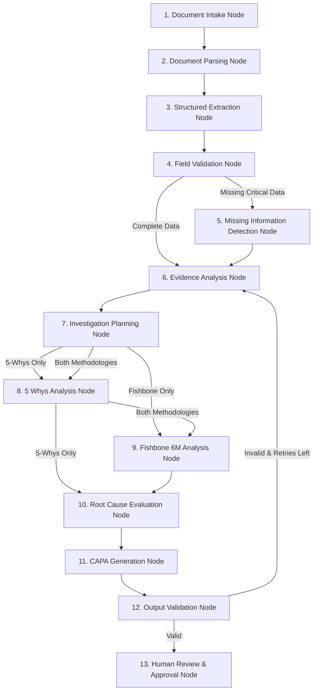

# AIVOA.AI RCA Intelligence – Technical Architecture

## 1. System Overview

**AIVOA.AI RCA Intelligence** is an engineering decision-support prototype platform engineered specifically for Active Pharmaceutical Ingredient (API) manufacturing quality assurance.

The system adheres strictly to the mandated technology stack and engineering principles:
- **Frontend**: React 19, Redux Toolkit 2.x, Tailwind CSS v4, Lucide Icons
- **Backend**: Python 3.12, FastAPI, Pydantic v2
- **Orchestration**: LangGraph StateGraph (13-node investigation pipeline with conditional routing)
- **Inference**: Groq API (`ChatGroq` via `langchain-groq`, `openai/gpt-oss-120b` dynamically cataloged)
- **Database**: PostgreSQL 16 (via SQLAlchemy 2.0 AsyncIO with asyncpg; mandatory, fail-fast enforcement; Alembic migration versioning)
- **Compliance & Governance Alignment**: Technical controls are aligned with cGMP principles (FDA 21 CFR Part 211, ICH Q9 Quality Risk Management, ICH Q10 Pharmaceutical Quality System) and electronic record/audit integrity principles. As an engineering decision-support prototype, it provides computational recommendations and investigator-controlled verification workflows; it does not claim autonomous regulatory certification or replace formal computerized system validation (CSV).


---

## 2. Two-Panel Enterprise Interaction Architecture

```
+-----------------------------------------------------------------------------------------------+
|                                  AIVOA.AI RCA INTELLIGENCE                                    |
| [Investigation Selector] | [Active Stage Stepper: Intake -> Investigation -> RCA -> CAPA -> QA] |
+---------------------------------------------------------------+-------------------------------+
| LEFT PANEL (7 Cols) - Structured RCA Dossier                  | RIGHT PANEL (5 Cols) - Copilot|
| - Deviation Details & Severity Classification                 | [Intake] [Gaps] [RCA] [Chat]  |
| - Manufacturing Context (Batch, Unit Op, Yield, Equipment)    | - PDF / Text / Email Ingestion|
| - Chronological Findings & Verifiable Evidence                | - Evidence Gaps & Questions   |
| - 5-Whys Causality Cascade                                    | - LangGraph RCA Generator     |
| - Ishikawa Fishbone Diagram (6Ms: Man, Machine, Material...)   | - Interactive QA Assistant    |
| - Synthesized Primary Root Cause & Contributing Factors       | - Live 12-Node State Trace    |
| - CAPA Program (Correction, Corrective Action, Preventive)    |                               |
| - QA Sign-Off (prototype electronic signature)               |                               |
+---------------------------------------------------------------+-------------------------------+
```

---

## 3. LangGraph 13-Node Investigation Pipeline

The investigation flow is orchestrated using LangGraph's compiled `StateGraph` with state-based conditional routing:



### Detailed Node Specifications:
1. **Document Intake Node**: Normalizes payload input (text, PDF bytes, or RFC 5322 email string) and initializes graph execution metadata.
2. **Document Parsing Node**: PyPDF reader extracts multi-page text and metadata; email parser extracts RFC 822 headers (From, Subject, Date) and incident body.
3. **Structured Extraction Node**: Calls Groq LLM with strict JSON schema to extract deviation numbers, batch numbers, equipment tags, yield metrics, and failure symptoms.
4. **Field Validation Node**: Validates presence of critical cGMP batch parameters (Batch ID, Product Name, Unit Operation).
5. **Missing Information Detection Node**: Scans available data against mandatory evidence types (calibration records, raw material CoAs, shift handover logs) and outputs targeted investigator questions.
6. **Evidence Analysis Node**: Correlates empirical evidence (SCADA telemetry, sensor trend logs) and executes unified causal inference, caching results in state to eliminate redundant calls.
7. **Investigation Planning Node**: Selects analysis methodology (`5_whys`, `fishbone`, or `both`) and establishes causal scope.
8. **5 Whys Analysis Node**: Generates a 5-tier causality chain from observable symptom down to management system inadequacy.
9. **Fishbone Analysis Node**: Evaluates all 6Ms (Man, Machine, Material, Method, Measurement, Milieu) and classifies causes into `HYPOTHESIS`, `CONFIRMED`, or `RULED_OUT`.
10. **Root Cause Evaluation Node**: Designates Primary Root Cause vs Secondary Contributing Factors with evidence citations.
11. **CAPA Generation Node**: Formulates Corrections (Containment), Corrective Actions (Prevent Recurrence), and Preventive Actions (Facility-wide) with assignees, deadlines, and quantitative effectiveness metrics.
12. **Output Validation Node**: Enforces the non-fabrication rule (`status != 'CONFIRMED'` for AI suggestions) and tags all AI outputs as `is_ai_suggested=True` and `is_verified=False`.
13. **Human Review Node**: Packages the dossier into database records for investigator review and QA electronic sign-off.

---

## 4. Database Relational Models (PostgreSQL 16)

- **`investigations`**: Master dossier record tracking stage, status, investigator, QA approver, and electronic sign-off.
- **`deviations`**: Manufacturing deviation details (batch, product, unit op, equipment, yields, description, containment, AI-populated flag, verified flag).
- **`evidences` & `investigation_findings`**: Traceable empirical facts, SCADA logs, analytical lab results, file attachments with SHA-256 hash digests and page-level source references.
- **`five_whys_steps`**: Dynamic-depth causal chain (not limited to 5 steps) with evidence references, verification status, investigator attribution (`verified_by_user_id`), and timestamps.
- **`five_whys_evidence_links`**: Relational junction connecting verified evidence to 5-Whys steps as `SUPPORTING` or `CONTRADICTORY` with confidence ratings and cross-investigation isolation guards.
- **`fishbone_causes`**: 6Ms factor nodes (MAN, MACHINE, MATERIAL, METHOD, MEASUREMENT, MILIEU) with status lifecycle (`HYPOTHESIS`, `VERIFIED`, `RULED_OUT`), rationale, investigator attribution (`verified_by_user_id`), and promotion linkage (`promoted_to_root_cause_id`).
- **`fishbone_evidence_links`**: Relational junction connecting verified evidence to Fishbone causes as `SUPPORTING` or `CONTRADICTORY` with confidence ratings and cross-investigation isolation guards.
- **`root_causes`**: Synthesized primary root cause and contributing factors with explicit provenance tracking (`source_type`: `FISHBONE`, `FIVE_WHYS`, `DIRECT_SYNTHESIS`, `MANUAL`; `source_id`), human confirmation attribution (`confirmed_by`, `confirmed_by_user_id`, `confirmed_at`), and rejection tracking (`rejection_reason`, `rejected_by`, `rejected_by_user_id`, `rejected_at`).
- **`root_cause_evidence_links`**: Relational junction connecting verified evidence to root causes as `SUPPORTING` or `CONTRADICTORY` with cross-investigation isolation guards.
- **`contradiction_dispositions`**: Formal disposition records requiring mandatory investigator rationale ($\ge 10$ chars) when resolving contradictory evidence links.
- **`evidence_gaps`**: Tracks missing empirical data items, investigator clarification questions, responses, and formal resolution links.
- **`capa_actions`**: Action items (`CORRECTION`, `CORRECTIVE_ACTION`, `PREVENTIVE_ACTION`) with owner, deadline, and effectiveness review criteria.
- **`ai_interactions`**: Complete log of prompts, model outputs, tokens, and model identifiers (`openai/gpt-oss-120b`).
- **`users`**: System user records (`INVESTIGATOR`, `QA_APPROVER`, `ADMIN`). In accordance with data integrity principles, user accounts cannot be physically deleted; account revocation is executed via soft deactivation (`is_active = False`), preserving relational foreign keys and audit history.
- **`audit_logs`**: Immutable timestamped audit trail tracking every insert, update, verification, promotion, and QA sign-off.

---

## 5. Causal Evidence Linking & Verification Barriers

### Verification Barriers:
1. **5-Whys Verification Barrier (`POST /api/v1/five-whys/{id}/verify`):**
   - A 5-Whys step cannot be marked `is_verified=True` unless it is associated with at least one verified supporting evidence item (`relationship_type='SUPPORTING'`).
   - Prevents unevidenced causal reasoning from masquerading as verified facts.
2. **Fishbone Verification Barrier (`POST /api/v1/fishbone/{id}/verify`):**
   - A Fishbone hypothesis cannot be transitioned to status `VERIFIED` without at least one verified supporting evidence link.
3. **Fishbone Cause Promotion (`POST /api/v1/fishbone/{id}/promote`):**
   - Investigators can promote verified Fishbone causes into formal `RootCause` proposals.
   - Initial status is always `PROPOSED` (AI/system cannot auto-confirm).
   - Provenance is preserved (`source_type='FISHBONE'`, `source_id=cause.id`).
   - Evidence links associated with the Fishbone cause are cloned into `root_cause_evidence_links`.
4. **Root Cause Confirmation Barrier & Role-Based Authorization (`POST /api/v1/root-causes/{id}/confirm`):**
   - Role Requirement: Strictly requires `QA_APPROVER` or `ADMIN` role. Standard investigators receive HTTP 403 Forbidden.
   - Separation of Duties: The assigned lead investigator cannot confirm their own root cause proposals even if possessing elevated roles.
   - Empirical Corroboration: A root cause can only transition to `CONFIRMED` if:
     - It has at least one verified supporting evidence link.
     - It has zero unresolved contradictory evidence links (all contradictions must have formal dispositions with scientific rationales $\ge 10$ chars).
     - The confirming QA approver provides their name and a mandatory justification ($\ge 10$ chars).
     - System securely populates `confirmed_by`, `confirmed_by_user_id`, and `confirmed_at` from authenticated server-side session.
5. **Evidence Verification Separation of Duties & Fail-Closed Legacy Policy (`POST /api/v1/evidences/{id}/verify`):**
   - Attributable Evidence (`uploaded_by_user_id IS NOT NULL`): The user who originally uploaded the evidence cannot verify it (`uploaded_by_user_id == current_user.id` returns HTTP 403 Forbidden). Verification requires an independent peer investigator, QA approver, or admin.
   - Unattributable Legacy Evidence (`uploaded_by_user_id IS NULL`): Fails closed. Standard investigators (and assigned lead investigators) receive HTTP 403 Forbidden. Only `QA_APPROVER` or `ADMIN` roles may verify legacy records. Historical uploader is never fabricated or inferred.
   - Attribution: Verification identity is derived strictly from the active server session (`verified_by`, `verified_by_user_id`, `verification_date`). Client-supplied attribution values are disregarded.
6. **Cross-Investigation Evidence Isolation & Causal Provenance Integrity:**
   - Strict server-side validation blocks linking evidence from Investigation A to Whys, Fishbone causes, or Root Causes belonging to Investigation B (HTTP 400 Bad Request).
   - Provenance (`source_type`, `source_id`) and verification flags cannot be altered via generic update endpoints.
   - Five Whys steps and Fishbone causes referenced by active root causes are protected against deletion (HTTP 409 Conflict).
7. **Fishbone Promotion Concurrency Safety:**
   - Promotion utilizes database row-level locking (`with_for_update()`) and rejects duplicate promotion attempts with HTTP 409 Conflict.
8. **Provenance Deletion Concurrency Serialization:**
   - Evaluated and mitigated race condition between `POST /investigations/{id}/root-causes` (creating a root cause referencing a Five Whys step or Fishbone cause) and concurrent `DELETE /five-whys/{id}` or `DELETE /fishbone/{id}`.
   - Implemented database row-level locking via `with_for_update()` on source step/cause during root cause creation and source deletion.
   - Competing transactions serialize: If deletion commits first, creation cleanly fails with HTTP 400 Bad Request (source missing). If creation commits first, deletion detects the active root cause reference and fails with HTTP 409 Conflict. Dangling provenance references are prevented.


---

## 6. Itemized Human-in-the-Loop RCA Review

To preserve investigator agency and cGMP compliance, blind bulk-overwriting of investigations via AI synthesis is superseded by granular itemized review:
- **Granular Review Endpoint (`POST /api/v1/copilot/apply-rca-item`):** Accepts individual proposal units (`item_type`: `FIVE_WHYS`, `FISHBONE`, `ROOT_CAUSE`, `CAPA`, `GAP`), recording granular audit log entries and preventing unwanted field destruction.
- **Enriched RCA Prompt:** The LangGraph/Groq engine ingests verified empirical findings, verified 5-Whys steps, verified Fishbone causes, and confirmed root causes to generate contextually grounded proposals.

